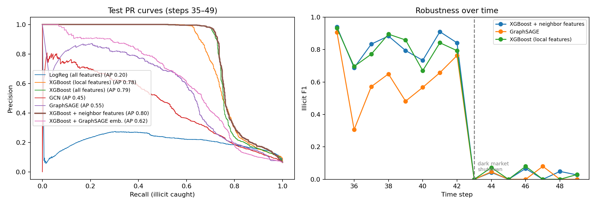

# Fraud Detection on a Transaction Graph: XGBoost vs. Graph Neural Networks

Illicit-transaction detection on the **Elliptic Bitcoin dataset**: 203,769 transactions, 234,355 payment flows, and about 2% labeled illicit. It compares tabular, graph, and hybrid models under a **strict temporal split**, and reports the trade-off that matters in production: **how much fraud you catch at a precision that keeps legitimate users unblocked.**

## What's inside
| Step | Method |
|---|---|
| Split | Train on time steps 1–29, validate on 30–34 (early stopping and thresholds), test on 35–49 (no future leakage) |
| Tabular | Logistic regression; XGBoost on local features and on all 165 features (class-weighted, early stopping on PR-AUC) |
| Graph | GCN and GraphSAGE (full batch, class-weighted loss) |
| Hybrid | XGBoost + hand-built neighbor features; XGBoost + GraphSAGE embeddings |
| Metrics | PR-AUC; illicit F1 at a validation-tuned threshold; **recall at ≥90% precision**; F1 per time step (dark-market shutdown at step 43) |

## Results
<!-- RESULTS: filled in from results/results.json -->
Test set: time steps 35–49 (16,670 labeled transactions, 6.5% illicit). Thresholds were tuned on validation (steps 30–34).

| Model | PR-AUC | Illicit F1 | Precision | Recall |
|---|---|---|---|---|
| Logistic regression (all features) | 0.20 | 0.31 | 0.20 | 0.75 |
| GCN | 0.45 | 0.49 | 0.49 | 0.49 |
| GraphSAGE | 0.55 | 0.60 | 0.64 | 0.57 |
| XGBoost + GraphSAGE embeddings | 0.62 | 0.61 | 0.64 | 0.58 |
| XGBoost (local features) | 0.78 | 0.72 | 0.73 | 0.71 |
| XGBoost (all features) | 0.79 | **0.75** | 0.76 | 0.74 |
| **XGBoost + neighbor features** | **0.80** | 0.72 | 0.70 | 0.75 |

**Takeaways**
- **Gradient-boosted trees beat GNNs** on this dataset (0.80 vs. 0.55 PR-AUC), consistent with Weber et al. (2019). Neighbor features add only a small gain, because the 165 features already include 1-hop aggregates.
- **Concept drift dominates:** the best model's illicit F1 falls from **0.85 (steps 35–42) to 0.03 (steps 43–49)** after the dark-market shutdown. Every model fails on the new fraud patterns, which motivates drift monitoring and frequent retraining.
- **Thresholds don't transfer over time:** a threshold tuned for 90% precision on validation reached only 54–62% precision on test.

## Run it
Open in Colab → Run all (about 10 minutes on a T4 GPU; also runs on CPU). The data downloads automatically through PyTorch Geometric.

## Reference
Weber et al., *Anti-Money Laundering in Bitcoin: Experimenting with Graph Convolutional Networks for Financial Forensics*, KDD Workshop on Anomaly Detection in Finance, 2019.

## Author
Pratiksha Chaudhari, PhD candidate in Computer Science, The University of Alabama.
